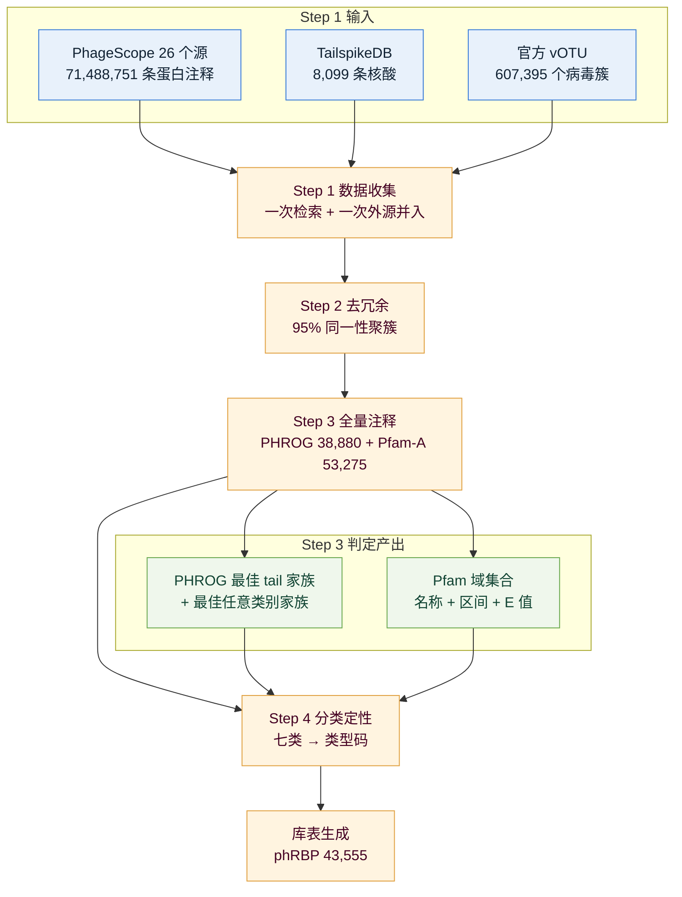

# phRBP —— 噬菌体尾部受体结合蛋白数据库

> **公开仓库说明（2026-11-20）**
> 本仓库是 `phrbp/` **v1.4** 的**数据发布版**：主表（xlsx / TSV）、序列 FASTA 与构建说明。按发布约定，**建库脚本 `scripts/` 未随本仓库公开**；README 中 `../tools/`、服务器工作目录等均为本地流程留痕，不是仓库内可直接运行的内容。
> 数据文件与本地 `phrbp/` 一致，未做修改。

> **关于 `_archive/`**：仓库内 `_archive/rbp_db_sample.tsv` 与 `RBP_db_sample.xlsx` 是 2026-11-20 的**字段示例切片**（旧 schema，12 行），只用于演示字段含义，**不作为当前库口径**；当前口径以本目录 `rbp_db_index.tsv`（43,555 × 31）为准。

> **版本 v1.4｜2026-11-23（当前）**
> 1. **长度元数据修复**：381 条 `length=0` 全部回填真实长度（raw_len 口径 = FASTA 原始字符数，含末尾 `*`）；
> 另把 127 条历史上按 clean 口径记录的行统一 +1，全表口径一致。回填后 `length=0` 为 **0**。
> 2. **Q1 漏收补录 5 条**：`phRBP_04_00928–00932`（TP-J34 / T12 / Pascal / Pookie / 01205 尾纤维），
> `class=P_RBP`、`subtype=lit_curated`、`has_tail_domain=1`；主库 43,550 → **43,555**。
> 3. **gp38 装配伴侣**：`phRBP_04_00883/00884` 的 `subtype` 由 `receptor` 改为 **`tail_fiber_assembly`**
>（class 仍为 P_RBP；下游做 RBD 正样本时必须按 subtype 过滤）。
> 4. **D4 域复核升库 2 条**：`phRBP_11_00197`（PF24801 tip attachment J）、`phRBP_11_01889`（PF12571 + PF21916 Mtd）
> → `class=P_RBP`、`subtype=fiber_by_domain_strong`；另有 7 条只获纤维结构域、仍留 `W_other_tail`。
> 5. P_RBP **35,698** / W_other_tail **7,857**；`length` 中位 **455 aa**（p10 = 168，p90 = 1,130）。
>
> 变更明细与哈希：见本仓库 2026-11-23 的 commit 内容。

> **版本 v1.3（历史）｜2026-11-22**
> 2026-11-22 增补两批：第一批 Q2 atlas **124 条新 RBP**（62 fiber / 32 W_tail_domain / 30 W_no_domain）同步进主库；随后把 43 条 atlas clean-merge 行按 source 记录拆成 **42 条新 RBP**（42 个 source tag / 34 条不同序列；同一序列的不同噬菌体记录各给独立 ID；仅 Bas01/Bas02 同 tag 共用 phRBP_06_02221）（2 fiber / 32 receptor / 8 fiber_by_domain）。`rbp_db_index.tsv`、`rbp_db.fasta`、`index.xlsx` 与 `rbp_to_host` 均已追加；主库由 43,384 → 43,508 → **43,550 条**。新增编号接全库各类型最大号：`phRBP_01_21365–21428`、`phRBP_04_00896–00927`、`phRBP_06_02216–02223`、`phRBP_09_01762–01793`、`phRBP_10_04064–04093`。原 43,384 条记录及其 ID 未改动。
>
> **版本 v1.2（历史）｜2026-11-22**
> 第一批 atlas 124 条新 RBP 入库，主库 43,384 → 43,508；本版记录数与类型页已被 v1.3 取代，保留作历史。

> **版本 v1.1（历史）｜2026-11-20**
> 2026-11-20 增补：29 条文献 curated 正样本与库做 95% 双向覆盖去冗余（5 条完全一致、**8 条 ≥95% 同源跳过**），**16 条新增入库**；同日按 A 方案**摘除 12 条 gp38 装配伴侣**（`phRBP_04_00885`–`00895`、`phRBP_01_21356`）。当日收口 **43,384 条**（历史基线；2026-11-22 v1.3 已增至 43,550）。正文中标注“43,366 基线”的覆盖率数字尚未逐项重算。
> 本文档只讲一件事：**这份库是怎么来的**。写作口径按要求做了归并——关键词检索是**一次检索**、外部补充数据是**一次收集**、结构域注释是**全量注释**，不再叙述历史上分轮补做的过程（过程留痕见 `../temp/archive_2026-11-14/`）。


---

## 一、这是什么

| 项 | 内容 |
|---|---|
| 记录数 | **43,555** |
| 列数 | 31 |
| 收录范围 | **P_RBP（宿主识别蛋白）+ W_other_tail（泛称尾部蛋白）**。Z / N1 / N2 / N3 / N4 一律不进 |
| 序列 | `rbp_db.fasta`，表头已替换为库内 ID |
| 主表 | `index.xlsx`（4 个工作表：`index` / `类型码` / `说明` / `数据集构成`）、`rbp_db_index.tsv` |
| ID 规则 | `phRBP_<类型码>_<该类 5 位顺序号>` → 例 `phRBP_01_00023` |
| 长度 | 中位 **455 aa**（p10 = 168，p90 = 1,130；范围 21–6,683） |
| 域证据 | 70.9%（30,885 条）有至少 1 个 Pfam 域；含尾部结构域 15,093 条 |

### 1.1 类型码

| 码 | 类型 | 判定依据 | 条数 |
|---|---|---|---|
| **01** | tail fiber | PHROG 家族名直接判定为尾丝 | 21,427 |
| **02** | tail spike | 家族名 tail spike / tailspike，且无多糖酶域 | 6,879 |
| **03** | depolymerase | 有多糖裂解/水解域，或名称含 depolymerase / lyase / sialidase 等 | 2,714 |
| **04** | receptor | receptor / host specificity / host recognition / adhesin | 916 |
| **05** | collar fiber | 颈环纤维（collar 与 fiber 共现） | 1,530 |
| **06** | fiber_by_domain | 只有纤维域或识别域证据，家族名未直接指明 | 2,223 |
| **09** | W_tail_domain | 泛称 tail，但带尾部结构域 | 1,793 |
| **10** | W_no_domain | 泛称 tail，且**无任何 Pfam 域** | 4,093 |
| **11** | W_other_domain | 泛称 tail，域全部与尾部无关 | 1,975 |
| | | **合计** | **43,555** |

> 06–08 空号，预留给后续细分（如把 06 拆成"识别域"与"纤维重复域"）。

---

## 二、总体流程：四步，每步只执行一次



| 步骤 | 输入 | 输出 | 关键动作 |
|---|---|---|---|
| 1 收集 | 26 个源 71,488,751 条 + TSPDB 8,099 条 | **300,475 条**（唯一 ID 300,193）+ TSPDB 8,084 | 关键词一次检索、vOTU 白名单过滤、外源一次并入 |
| 2 去冗余 | 308,277 条 | **98,535 簇代表** | mmseqs 95% 同一性 + 90% 双向覆盖 |
| 3 全量注释 | 308,277 条 | PHROG + Pfam-A 两份 domtbl | 38,880 + 53,275 个 HMM 全量跑，不预筛 |
| 4 分类定性 | 注释结果 | 七类 + 子类 | 负证据优先 → 部件定性 → 正证据 |

---

## 三、Step 1 数据收集（一次检索 + 一次外源并入）

### 3.1 关键词检索：一次下发 12 组词表

检索对象是 PhageScope 26 个源注释表的 `Product` 字段（71,488,751 条），**不匹配序列、不匹配基因名**。12 组词表一次性下发，命中即归类，**顺序短路**（先命中先定组）。

| 组 | 词表（正则原文） | 原始命中 |
|---|---|---|
| G1 尾丝 | `tail fib(er\|re)`｜`fibre protein`｜`fiber protein` | **209,769** |
| G2 尾刺 | `tail spike`｜`spike protein` | 2,666 |
| G3 解聚酶 | `depolymerase` | 546 |
| G4 受体/RBP | `receptor[- ]binding`｜`\brbp\b` | 612 |
| G5 尾尖/尾针 | `tail tip`｜`tail needle`｜`needle protein`｜`tail-associated lysin` | 6,235 |
| G6 酶学专名（11 个） | `pectate lyase`｜`pectin lyase`｜`endosialidase`｜`sialidase`｜`hyaluronidase`｜`hyaluronate lyase`｜`alginate lyase`｜`rhamnogalacturonase`｜`polysaccharide lyase`｜`glycoside hydrolase`｜`depolymerase` | **66,111** |
| G7 远端尾 | `distal tail` | 13,432 |
| G8 黏附素 | `\badhesin\b` | 12,535 |
| G9 尾刺连写 | `tailspike`｜`tail-spike` | 389 |
| G10 宿主特异性 | `host specificity` | 146 |
| G11 基因别名 | `gp37`｜`gp38`｜`gp12`｜`gp11` | 33,743 |
| G12 受体结合（无连字符） | `receptor\s+binding` | 0（G4 已覆盖） |

**排除词**（命中即在检索阶段拦掉）：
`assembly`｜`chaperone`｜`RNA[- ]binding`｜`ribosome[- ]binding`｜`retinol[- ]binding`｜`transporter`｜`autotransporter`｜`secretory`

**净得**：346,184 条原始命中 → 去重 → **217,894**（G1–G5 主体）+ **82,299**（G6–G12 补充）= **300,193 条唯一蛋白**。

> **两处以序列为准的处置**（不能只靠文本）：
> 1. **G11 全部剔除**。`gp37`/`gp12` 这类编号别名在 33,743 条里绝大多数指结构蛋白或衣壳蛋白，无语义指向。
> 2. **G8 只保留 2,996 条（24%）**。`adhesin` 有 76% 是细菌自转运蛋白（AidA 类），唯一可靠判据是**基因组在不在病毒白名单**，而不是 ID 里有没有细菌名——BAPS 的 ID 带大肠杆菌名，实际是原噬菌体区。

### 3.2 病毒来源白名单

用官方 vOTU（**1,350,636 个基因组 → 607,395 个 vOTU**，MIUViG 标准：ANI ≥ 95% 且覆盖 ≥ 85%）作白名单，凡 `Phage_ID` 不在白名单内的一律丢弃。

这一步在 G8 上剔掉 76% 的细菌蛋白，在 G6 上验证了 66,111 条酶学命中**全部是噬菌体编码**（不是细菌裂解酶混入）。

### 3.3 外部补充数据：一次并入

四份外部资产在**同一步**读取、各自承担一个用途，不分工期。

| 资产 | 规模 | 在本库中的用途 | 处理 |
|---|---|---|---|
| **TailspikeDB** | 8,099 条**核酸**（中位 2,736 bp） | **入池**，提供人工核验的尾刺金标准 | 六框翻译取最长 ORF（≥100 aa、M 起、无内部终止）→ **8,084 条蛋白**，中位 893 aa |
| **官方 vOTU** | 607,395 个簇 | 病毒来源白名单 | 见 3.2 |
| **PhReD** | 672 条带受体类型与宿主 | `receptor_type` / `host_species` 标签 | mmseqs 同源映射（10 列 m8），命中 593 / 672，池侧 13,610 |
| **BFVD** | 351,242 个 PDB / 41 GB | 结构层面交叉校验（**不入库**） | 宽松匹配 40.4%，背景筛查后可靠锚点 5.4% |

> ⚠️ **TailspikeDB 给的是核酸不是蛋白**。文件头和 accessions 看起来像蛋白，实际是 ACGT，直接做 HMM 比对会零命中。这条在复现时最容易踩。

### 3.4 收集结果

| 批次 | 条数 |
|---|---|
| PhageScope 26 源（关键词检索 + 白名单） | 300,193 |
| TailspikeDB（翻译后） | 8,084 |
| **合计** | **308,277** |

> 拼接前处理了两个数据问题：池内 **282 个蛋白 ID 重名**（其中 272 组序列实际不同，差 1 aa，两次注释版本拼接所致）→ 同 ID 保留最长；池与 TSPDB 有 **1 个 ID 冲突** → TSPDB 统一加 `TSPDB_` 前缀。

---

## 四、Step 2 去冗余（95%）

```bash
mmseqs easy-cluster combined_pool_tspdb.faa nr95_v5 tmp_nr95_v5 \
  --min-seq-id 0.95 \
  -c 0.9 \
  --cov-mode 0 \
  --cluster-mode 0 \
  --threads 120
```

| 参数 | 含义 | 为什么这么定 |
|---|---|---|
| `--min-seq-id 0.95` | **序列同一性**（默认 0.0） | 决定"是否同一蛋白"的唯一参数 |
| `-c 0.9` | **覆盖度**（不是同一性） | 双向覆盖 ≥ 90%，防短片段吞掉全长 |
| `--cov-mode 0` | 双向覆盖 | 模式 1 只看 target，会放过"半条命中全长" |
| `--cluster-mode 0` | set-cover 贪心 | 模式 1 连通分量会链式膨胀 |
| `-s` 省略 | 预过滤灵敏度，默认 5.7 | — |

| 结果 | 数值 |
|---|---|
| 输入 | 308,277 |
| 输出簇 | **98,535** |
| 压缩率 | 68.0% |
| 单例簇 | 68,721（69.7%） |
| 平均 / 最大簇 | 3.13 / 1,714 |
| 簇内类别一致 | **99.98%**（98,520 簇全一致，仅 15 簇不一致） |

> 99.98% 的簇内一致率意味着"**用簇代表代理整簇标签**"是安全的，不需要逐成员建模。

---

## 五、Step 3 全量注释（PHROG 38,880 + Pfam-A 53,275）

**全量**的含义：两个库都按 **HMM 模型的完整规模**跑，不做任何预筛、不分批补做。所有 308,277 条序列用同一套参数一次注释完。

| 库 | 模型数 | 说明 |
|---|---|---|
| **PHROG** | **38,880** | 噬菌体专用家族库；配套 annot 表 109,404 个家族（含注释文本与 category） |
| **Pfam-A** | **53,275** | Pfam 全量（3.4 GB），**不是**预先挑选的几十个域子集 |

```bash
# 参数（两库一致）
hmmsearch --domtblout <out>.domtbl -E 1e-5 --domE 1e-5 --cpu 20 --noali <hmm> <seqs>
```

**工程要点**：`hmmsearch` 的 `--cpu` 对大量小模型近乎无效（实测 150 线程只跑 6.7 核）。正确做法是**把 HMM 库按 `//` 切成 8 片、起 8 个进程并行**，实测加速 **8.9 倍**（4.66 → 32.5 模型/秒）。

### 注释覆盖率

| 对象 | PHROG | Pfam-A | 含尾部结构域 |
|---|---|---|---|
| 主池 300,193 | 86.81% | 62.16% | — |
| TailspikeDB 8,084 | **99.8%** | **96.9%** | 85.1% |
| 最终库 43,555（含 atlas 166） | — | **70.9%**（30,885 / 43,555 实算） | 34.7%（15,093 / 43,555 实算） |

> Pfam 侧 29.1% 无域是真实情况：宏基因组来源的短片段蛋白与全新折叠家族本就落在 Pfam 覆盖之外。这部分在库中由 `10_ W_no_domain` 单列，不混入有域记录。

---

## 六、Step 4 分类定性（七类 → 类型码）

### 6.1 判定顺序：负证据优先

这是整条流水线最容易被写错的一步。**负证据（门控、肽聚糖域）必须排在正证据（家族名）之前**，否则 1,855 条家族名写 `tail fiber` 但带 GH19/CHAP 的内溶素会全部回流进 RBP。

```
① 门控 G       最佳任意类别 ≠ tail，且有实质注释，且 E_any × 100 ≤ E_tail
                → lysis → N4_lysis；其他 → Z_non_tail
               （若带尾部结构域则豁免，见 6.2）
② 肽聚糖水解域  CHAP / GH25 / 溶菌酶 / 酰胺酶 → N4_lysis
③ 部件定性      N2 组装伴侣（含 T4 gp63 型连接催化酶）→ N3 侵染执行（尾针/VAPGH）→ N1 骨架
④ RBP 正证据    spike → receptor → collar fiber → fiber，各自落到对应子类
⑤ 域独立支撑    仅有多糖酶域或识别域、家族名泛称 → 仍判 P_RBP
⑥ 兜底          含 tail 但以上全不命中 → W_other_tail；否则 Z_non_tail
```

### 6.2 尾部结构域豁免

门控 G 的依据是 PHROG 的 `category` 字段，而 **PHROG category 不是功能判据**——95.2% 的家族注释是 `unknown function`，`minor head protein` 这类家族名下实际装着大量尾部蛋白。

用 TailspikeDB 的 8,084 条人工尾刺做探针验证：不加豁免时只有 12% 被判为 P_RBP，**3,823 条被门控打掉**，而它们的 Pfam 域是 Prophage_tail（2,752）、Phage_tail_N_6（1,087）。

修法：门控触发前先查**域名的语义**（不硬编码 PF 号），命中即豁免。

```python
TAILNAME = re.compile(r'tail|fib(er|re)|spike|Phage_RBD|baseplate|sheath'
                      r'|(\btube\b|_tube|tube_)|needle|collar|gp58', re.I)
# 注意：rbd 必须限定为 Phage_RBD，裸 rbd 会匹配到 dsRBD / PI3K_rbd 等 RNA 结合域
```

### 6.3 复合注释的两条例外

同时含骨架词与 RBP 词的注释共 386 条，不能一律判给 RBP：

| 注释形态 | 条数 | 正确归属 |
|---|---|---|
| `tail collar fiber protein` | 1,543 | **P_RBP / collar_fiber**（59% 带纤维域） |
| `baseplate wedge tail fiber protein connector` | 266 | **N1**——connector 是衔接件，tail fiber 是它连接的对象 |
| `collar tail protein for L-shaped fibre attachment` | 18 | **N1**——"for X attachment" 的 X 不是自身功能 |
| `tail sheath and receptor binding protein` | 10 | P_RBP / receptor |

规则化成两条语法例外：`\bfor\b.{0,60}\b(attachment|assemble|assembly|anchoring)` 与 `connector|adaptor|linker`。

### 6.4 从七类到类型码

| 七类 | 条数（池内 91,764） | 进入本库？ | 类型码映射 |
|---|---|---|---|
| P_RBP | 28,794 | ✅ | 按 subtype 拆 01 / 02 / 03 / 04 / 05 / 06 |
| W_other_tail | 7,801 | ✅ | 按域证据拆 09 / 10 / 11 |
| Z_non_tail | 45,540 | ❌ | — |
| N2_chaperone | 6,826 | ❌ | — |
| N4_lysis | 1,903 | ❌ | — |
| N1_skeleton | 483 | ❌ | — |
| N3_infection_exec | 417 | ❌ | — |

去冗余后取 P_RBP **35,698** + W_other_tail **7,857** = **43,555**，即本库全体。其中 16 条为 2026-11-20 文献新增，124 条为 2026-11-22 atlas 新 RBP，42 条为 atlas clean-merge 拆分，12 条 gp38 已按 A 方案摘除。

---

## 七、字段字典（31 列）

| # | 列名 | 来源 | 说明 |
|---|---|---|---|
| 1 | `rbp_id` | 生成 | `phRBP_<类型码>_<5 位序号>` |
| 2–3 | `type_code` / `type_name` | 生成 | 见 §1.1 |
| 4 | `original_id` | 原始注释表 | 原名，可反查源库 |
| 5 | `source_db` | 生成 | `PhageScope`（36,519）/ `TailspikeDB`（6,849）/ `Literature`（16）/ `Atlas`（166） |
| 6 | `source_pipeline` | 生成 | `keyword+PHROG` / `TSPDB` / `curated-literature` |
| 7 | `genome_id` | PhageScope 注释表 `Phage_ID` | 基因组归属 |
| 8 | `votu_id` | vOTU members 表 | 病毒簇归属 |
| 9 | `checkv_quality` | vOTU members 表 | Complete / High / Medium / Low-quality |
| 10 | `votu_size` | vOTU members 表 | 簇内基因组数 |
| 11 | `host_species` | TSPDB header + PhReD 映射 | 宿主物种 |
| 12 | `receptor_type` | PhReD 映射 | 受体类型（PhReD 原始自由文本；取自 `phred_rbp.faa` 未截断 header） |
| 13 | `receptor_source` | PhReD | 标签来源蛋白（`PhReD:<PhReD accession>`） |
| 14 | `eop_value` | — | **当前为空**（无定量 EOP 数据） |
| 15–16 | `class` / `subtype` | 分类流水线 | 七类与子类 |
| 17 | `length` | 序列 | aa |
| 18–19 | `phrog_tail_family` / `phrog_tail_annot` | PHROG | 最佳 **tail 类**家族 |
| 20–23 | `phrog_any_family` / `_annot` / `_category` / `_evalue` | PHROG | 最佳**任意类别**家族（门控依据） |
| 24 | `pfam_ids` | Pfam-A 全量 | 全部域 ID，分号分隔 |
| 25 | `n_domains` | 生成 | 域种类数 |
| 26 | `has_poly_domain` | 域集合 | 含多糖裂解/水解域；**旧 6 标记口径**（PF12708/PF00544/PF02278/PF08787/PF00657/PF01464），与 `tools/build_v5.py` 的 21 域 `POLY` 不一致。2026-11-22 已生成 `rbp_db_index_v2_2026-11-22.tsv`，新增 `has_poly_domain_21`（21 域口径）与 `poly_domain_diff`；全库 180 条差异，逐条见 `../data/q1_has_poly_domain_21_audit_2026-11-22.tsv`。 |
| 27 | `has_tail_domain` | 域名语义 | 含尾部结构域 |
| 28 | `cluster_size` | 去冗余簇表 | 簇内成员数 |
| 29 | `cluster_vote_frac` | 去冗余簇表 | 簇内类别一致比例 |
| 30 | `is_gold` | 生成 | 1 = TailspikeDB 金标准（6,849 条） |
| 31 | `lit_annot` | 文献 | 文献给出的功能注释；当前仅补在 PHROG 注释为 unknown 的 2 条 curated 条目（`phRBP_10_04062`、`phRBP_10_04063`） |

---

## 八、覆盖度与已知缺口

| 标签 | 覆盖 | 说明 |
|---|---|---|
| `genome_id` / `votu_id` | **84.2%**（36,517） | 非 TSPDB 部分**全覆盖**；TSPDB 来自 GenBank CDS，无 PhageScope 基因组归属 |
| `host_species` | 17.4%（7,544） | 主要来自 TSPDB header 与 PhReD 映射 |
| `receptor_type` | 6.2%（2,674，43,366 基线） | PhReD 映射池内 13,610 条，与 43,366 个**簇代表**只有 2,674 重叠（43,550 版未逐项重算）。⚠️ 现表曾从 m8 截断 query 取值，只剩 49 个残片；已改为回连 `phred_rbp.faa` 原始 header（672 个 accession → 78 种受体文本、30 种宿主文本，2026-11-18 修复脚本；**现表尚未重建**） |
| `eop_value` | **0%** | 无数据，留空列占位 |

**三个已知缺口，按优先级**：

1. **受体标签是最大短板**（6.2%）。改进方向：把 PhReD 的前述 13,610 条映射到簇代表时改用簇内全网兜底（成员命中即认），预计可提升到 30% 量级。
2. **EOP 没有任何定量数据**。需要文献挖掘或实验补充，短期不解决。
3. **29.1% 无任何 Pfam 域**。这部分集中在 `10_ W_no_domain`（4,061 条），作为弱负样本或待定项使用，不建议直接当正样本训练。

---

## 九、复现路径

| 步骤 | 脚本 | 位置 | 作用 |
|---|---|---|---|
| 1 | `build_dedup_input.py` | `../tools/` | 造去冗余输入：同 ID 保留最长、TSPDB 加前缀 → 308,277 条 |
| 2 | `run_tspdb_annot.sh` | `../tools/` | PHROG + Pfam-A 全量注释，8 片并行 |
| 3 | `run_dedup_v4.sh` | `../tools/` | mmseqs 95% 去冗余 → 98,535 簇 |
| 4 | `build_rbp_db.py` | **本目录 `scripts/`** | 分类映射 + 建索引 + 写 fasta |
| 5 | `rescan_map.sh` | **本目录 `scripts/`** | 扫 26 张注释表建 protein → Phage_ID 映射 |
| 6 | `mkxlsx_full.py` | **本目录 `scripts/`** | TSV → xlsx（格式、筛选、四页） |
| 7 | `sample_rbp_db.py` | **本目录 `scripts/`** | 抽样校验（生成 12 行样例） |

> 步骤 1–3 属通用数据集流水线，留在 `../tools/`；步骤 4–7 是 RBP 库专属，随本库一起放在 `scripts/`。

服务器工作目录：`/home/data/zhaoxin/new_project/protein_data/20_v3_dataset/27_tspdb_add/`

---

## 十、目录内容

```
phrbp/
├── README.md              本文档
├── index.xlsx             主表（4 页：index / 类型码 / 说明 / 数据集构成）
├── rbp_db_index.tsv       同内容 TSV，供命令行处理
├── rbp_db.fasta           43,555 条序列，表头 = rbp_id
├── scripts/
│   ├── build_rbp_db.py    分类映射 + 建索引 + 写 fasta
│   ├── mkxlsx_full.py     TSV → xlsx（含格式、筛选、四页）
│   ├── rescan_map.sh      扫描 26 张注释表建 protein → Phage_ID 映射
│   └── sample_rbp_db.py   抽样校验（生成样例行）
└── _archive/              已清空；旧版本已迁至 `../rawdata/superseded_2026-11-22/phrbp_pre_atlas_sync/`
```

---

## 附：与上游数据集的关系

本库不独立于主数据集，是它的**子集导出**：

| 层级 | 对象 | 数量 |
|---|---|---|
| 收集 | 300,193 + TSPDB 8,084 | 308,277 |
| 去冗余 | 簇代表 | 98,535 |
| 分类 | 池内七类 | 91,764 |
| **导出** | **P_RBP + W_other_tail** | **43,555（本库；含 2026-11-22 atlas 增补 124 + clean-merge split 42 + 2026-11-23 补录 5）** |

若主数据集的分类口径更新（例如 `collar_fiber` 归回骨架），本库需同步重建：重跑 `scripts/build_rbp_db.py` 即可，索引号会按类型码重新编号——**旧 ID 不稳定，对外引用须连同 `original_id` 一起给出**。
